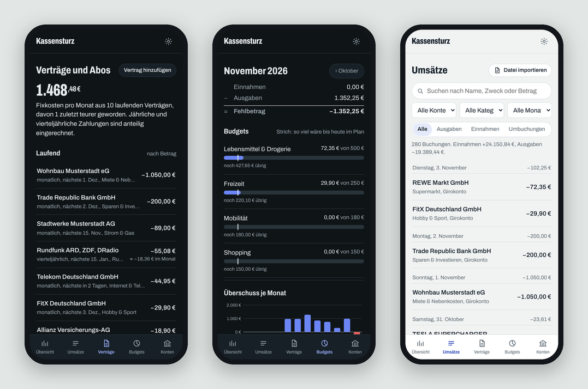

# Kassensturz

Haushaltsbuch als Home-Assistant-App: Umsätze per Open Banking, FinTS oder Eingangsordner, automatische Kategorien, Vertrags- und
Abo-Erkennung mit Preiserhöhungs-Hinweis, Monatsbudgets, Kontostand-Prognose bis zum nächsten Gehalt und
Kündigungsschreiben auf Knopfdruck. Läuft vollständig lokal – ohne Cloud, ohne Werbung, ohne Vertragswechsel-Angebote.


## Installation

1. In Home Assistant *Einstellungen → Apps → App Store* öffnen.
2. Oben rechts im Menü *Repositories* wählen und `https://github.com/uekala/kassensturz` hinzufügen.
3. **Kassensturz** installieren und starten. Die App wird auf dem Gerät gebaut; das dauert beim ersten Mal einige Minuten.
4. Über die Seitenleiste öffnen.

Ohne GitHub geht es auch lokal: den Ordner `kassensturz/` per Samba oder SSH nach `/addons/kassensturz` kopieren, im
App Store *Nach Updates suchen* und unter „Lokale Apps“ installieren.

Für den automatischen Abruf gibt es zwei Wege: Open Banking über Enable Banking (für eigene Konten kostenlos, auch für N26
und Revolut) oder FinTS mit einer kostenlosen Produkt-ID. Alles Weitere steht in der [Anleitung](kassensturz/DOCS.md).



*Die Bilder zeigen die Beispieldaten, die sich in der App mit einem Klick laden lassen.*

## Was anders ist als bei den bekannten Finanz-Apps

- **Lokal:** Daten bleiben auf dem Home-Assistant-Gerät. Bankabruf direkt per FinTS oder über die offizielle
  EU-Schnittstelle (Open Banking); für alles andere ein Eingangsordner, der Exporte selbst importiert.
- **Frei bis zum Gehalt:** Statt nur Kontostand zeigt die Übersicht die Rechnung Kontostand − feste Abbuchungen bis zum
  nächsten Gehaltseingang, dazu eine Tagesprognose.
- **Keine Doppelzählung:** PayPal-, Klarna- und Kreditkartenumsätze werden mit den Abbuchungen auf dem Girokonto verrechnet.
- **Nachvollziehbare Kategorien:** Jede Zuordnung zeigt, woher sie kommt; Korrekturen werden auf Wunsch zur Regel, mit
  Vorschau, wie viele Buchungen sie betrifft. Buchungen lassen sich aufteilen.
- **Verträge mit Gedächtnis:** Erkennung über Gläubiger-ID und Mandat, Hinweis bei Preiserhöhungen mit Mehrkosten pro Jahr,
  Erinnerung vor Ablauf der Kündigungsfrist, Kündigungsschreiben inklusive Mandatswiderruf.
- **Home Assistant:** Sensoren für Kontostand, frei verfügbaren Betrag, Prognose, Fixkosten und Budgets; Benachrichtigungen
  aufs Handy.
- **Offen:** Export aller Buchungen als CSV, kein Datensilo.

## Unterstützte Banken

Open Banking: alle Banken, die Enable Banking anbindet – darunter N26.
FinTS: Sparkassen, Volks- und Raiffeisenbanken, ING, DKB, comdirect und alle weiteren Banken mit FinTS-PIN/TAN.
Datei-Import und Eingangsordner: zusätzlich PayPal, American Express, Revolut, Klarna, Advanzia sowie CAMT.052/.053 und MT940.

## Eigenständiger Betrieb

Zusätzlich zum Home-Assistant-Add-on gibt es eine frühe Docker-Variante für Linux-Server.
Sie bindet aus Sicherheitsgründen zunächst ausschließlich an `127.0.0.1`; LAN- und Mobile-Zugriff sind
noch nicht freigegeben. Die [Anleitung für den eigenständigen Betrieb](deploy/standalone/README.md)
beschreibt Installation, Datenablage und Backup.

## Mobile-App für iOS und Android

Kassensturz erhält eine gemeinsame Flutter-App für iOS und Android. Die App kann Geräte per HTTPS mit einem eigenen Kassensturz-Server koppeln, Sitzungen sicher speichern, die Verbindung prüfen und Tokens automatisch erneuern. Dashboard, Konten und Buchungen verwenden derzeit weiterhin Demo- bzw. lokale Daten; die Integration der echten Serverdaten folgt. Der vorgesehene erste Server ist ein vorhandener Home Assistant Green. Details: [Mobile-Client-Roadmap](mobile/README.md), [API-Spezifikation](docs/architecture/0003-mobile-api-contract.md), [Flutter-Architekturentscheidung](docs/architecture/0006-flutter-mobile-client.md) und [Green-Deployment](docs/architecture/0007-home-assistant-green-deployment.md). Der isolierte Test-Rollout ist in der [Green-Test-Installationsanleitung](deploy/home-assistant-green/README.md) beschrieben.

## Entwicklung

```bash
cd kassensturz/app
pip install -r requirements.txt
KASSENSTURZ_DEV=1 KASSENSTURZ_DATA=/tmp/kassensturz python -m kassensturz
# Oberfläche: http://localhost:8099
```

Tests:

```bash
pip install pytest httpx
pytest tests
# optional mit der Test-Bank aus dem Quellcode von python-fints:
FINTS_TESTS_DIR=/pfad/zu/python-fints/tests pytest tests/test_fints_mock.py
```

Aufbau: FastAPI und SQLite im Backend (`kassensturz/app/kassensturz`), eine Oberfläche ohne Build-Schritt in `static/`.
FinTS übernimmt [python-fints](https://github.com/raphaelm/python-fints), Open Banking läuft über die API von Enable Banking. Die Schrift Archivo steht unter der SIL Open Font License.
