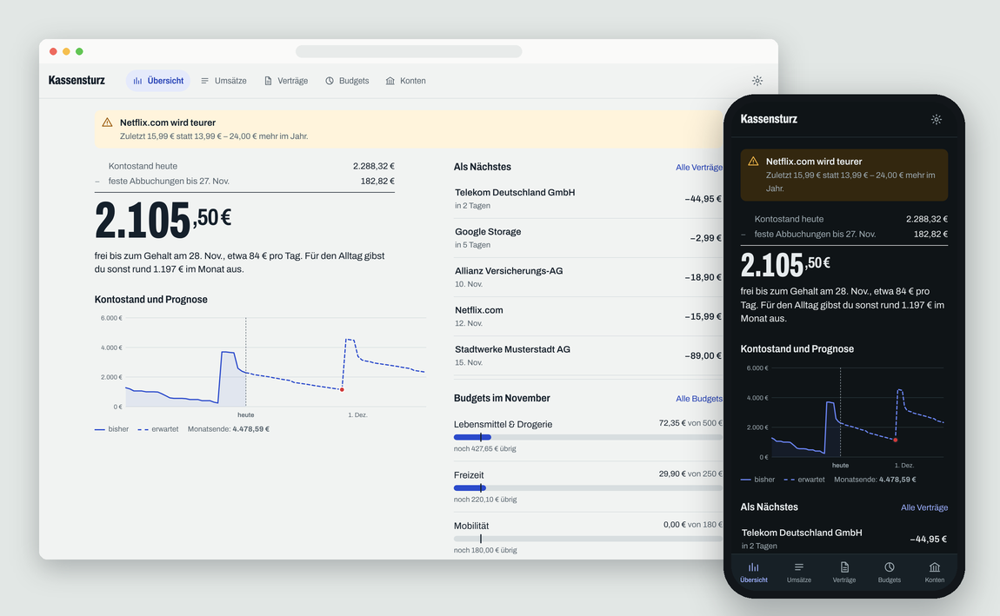

# Kassensturz

Kassensturz ist ein Haushaltsbuch für Home Assistant. Es sammelt die Umsätze deiner Konten, ordnet sie Kategorien zu,
erkennt Verträge und Abos und rechnet aus, wie viel bis zum nächsten Gehalt noch frei ist. Alle Daten bleiben auf deinem
Home-Assistant-Gerät.



## Erste Schritte

1. App starten, unter *Info* „In der Seitenleiste anzeigen“ einschalten und **Kassensturz** öffnen.
2. Eine Bank per Open Banking oder FinTS verbinden, eine Kontoauszug-Datei importieren oder erst einmal die Beispieldaten laden.
3. Für Konten ohne Saldo in der Datei (zum Beispiel Kreditkarten) einmal den aktuellen Kontostand eintragen.

Nach etwa drei Monaten Umsätzen erkennt Kassensturz die meisten Verträge von selbst.

## Was die Übersicht zeigt

Oben steht die Rechnung, die der App den Namen gibt: Kontostand heute, minus feste Abbuchungen bis zum nächsten
Gehalt, ergibt den Betrag, der für den Alltag frei ist. Darunter der Verlauf der letzten 30 Tage mit Prognose für die nächsten
45 Tage. Die Prognose rechnet erkannte Verträge zum jeweiligen Termin ein und für alles andere deine typischen Alltagsausgaben
der letzten drei Monate.

In die Summe fließen alle Konten ein, bei denen „Zählt zum Kontostand und zur Prognose“ aktiv ist. Tagesgeldkonten sind
standardmäßig ausgenommen.

## Bankabruf per Open Banking

Banken müssen in der EU eine Schnittstelle für Kontoumsätze anbieten (PSD2) – auch Neobanken wie N26 und Revolut, die kein
FinTS haben. Nutzen dürfen sie nur lizenzierte Dienste. Kassensturz verwendet dafür [Enable Banking](https://enablebanking.com):
Im „eingeschränkten Produktivmodus“ ist der Dienst für eigene Konten und private Nutzung kostenlos.

**Einmalig bei Enable Banking:**

1. Registrieren und im Control Panel unter *API applications* eine neue App anlegen: Umgebung *Production*, Redirect-URL
   `https://enablebanking.com/`, Schlüssel im Browser erzeugen lassen. Der Browser lädt eine `.pem`-Datei herunter.
2. Bei der App *Activate by linking accounts* wählen und deine Konten einmal verknüpfen. Nur so verknüpfte Konten lassen
   sich später abrufen.

**In Kassensturz:** *Konten → Open Banking einrichten*, App-ID und `.pem`-Datei eintragen. Danach *Bank verbinden*, Bank
auswählen, bei der Bank freigeben. Du landest anschließend auf der Seite von Enable Banking – die komplette Adresse aus der
Adresszeile kopierst du zurück in Kassensturz. Die Konten werden angelegt oder, wenn schon ein Konto mit derselben IBAN
existiert (etwa aus einem Datei-Import), mit diesem verknüpft.

**Abruf:** täglich zur eingestellten Uhrzeit und jederzeit von Hand. Beim ersten Abruf holt Kassensturz bis zu ein Jahr
Umsätze, sofern die Bank das erlaubt, sonst die letzten 89 Tage. Ohne dein Zutun erlauben Banken nur wenige Abrufe pro Tag.

**Freigabe erneuern:** Je nach Bank gilt die Freigabe bis zu 180 Tage. Eine Woche vor Ablauf erscheint ein Hinweis (auch als
Benachrichtigung); *Erneuern* führt durch dieselben Schritte, die Konten bleiben verknüpft.

Welche Banken Enable Banking anbindet, siehst du in der Bankauswahl. Manche stehen unter dem Land ihres Sitzes, PayPal
etwa unter Luxemburg. Für Banken, die dort fehlen, bleibt der Datei-Import; für Advanzia gibt es dafür ein eigenes Profil. Der private Schlüssel liegt nur auf dem Gerät und ist von Backups ausgenommen; nach einer
Wiederherstellung lädst du ihn einfach neu hoch.

## Bankabruf per FinTS

FinTS (früher HBCI) ist die Schnittstelle, über die auch Programme wie StarMoney oder Hibiscus Umsätze abrufen.
Sparkassen, Volks- und Raiffeisenbanken, ING, DKB, comdirect und viele weitere bieten sie an.

**Produkt-ID:** Seit 2019 akzeptieren Banken nur registrierte Programme. Die Registrierung bei der Deutschen Kreditwirtschaft
ist kostenlos (Formular auf [fints.org](https://www.fints.org/de/hersteller/produktregistrierung)); die Zuteilung kann bis zu
zwei Wochen dauern. Die erhaltene ID trägst du in der Konfiguration der App unter `fints_product_id` ein.

**Bankzugang anlegen:** Unter *Konten → Bank verbinden → FinTS*. Du brauchst die Bankleitzahl (Stelle 5 bis 12 deiner IBAN),
deinen Anmeldenamen aus dem Online-Banking und die FinTS-Serveradresse deiner Bank. Für ING, DKB, comdirect und die
Volksbanken ist die Adresse vorbelegt. Sparkassen nennen sie auf ihrer Website unter „HBCI“ oder „FinTS“.

**TAN:** Beim ersten Abruf fragt Kassensturz nach deinem TAN-Verfahren. Bei App-Verfahren (pushTAN, SecureGo plus,
Banking to go, DKB-App, photoTAN-Push) bestätigst du einfach in der App; Kassensturz wartet darauf. chipTAN mit Flickercode
und photoTAN-Grafiken werden direkt angezeigt.

Startest du den Abruf in der Mobile-App, erscheinen dieselben Rückfragen dort in der Karte *Bankabruf*. Die PIN gibst du
nie am Handy ein; das geht nur für Zugänge mit gespeicherter PIN.

**Automatischer Abruf:** Wenn du beim Abruf „PIN speichern“ wählst, ruft Kassensturz täglich zur eingestellten Uhrzeit ab.
Die PIN liegt dann in `/data/secrets.json` auf dem Gerät – nicht verschlüsselt, aber von Home-Assistant-Backups ausgenommen.
Die meisten Banken verlangen alle 90 bis 180 Tage eine neue TAN-Freigabe; dann meldet sich Kassensturz per Benachrichtigung
und du startest den Abruf einmal von Hand.

## Datei-Import

Für Konten, die weder Open Banking noch FinTS abdecken, und als Alternative für alle anderen. Erkannt werden:

| Bank | Format | Wo zu finden (meist) |
|---|---|---|
| Sparkasse | CSV-CAMT, CSV-MT940, CAMT (XML/ZIP), MT940 | Umsätze → Export |
| Volksbank / Raiffeisenbank | CSV | Umsätze → Export |
| ING | CSV | Umsätze → Download |
| DKB | CSV | Umsätze → Export |
| comdirect | CSV | Umsätze → Export |
| N26 | CSV | Web-App → Downloads |
| Revolut | CSV | Konto → Kontoauszug → Excel/CSV |
| PayPal | CSV | Aktivitäten → Kontoauszüge → Benutzerdefiniert |
| American Express | CSV | Umsätze → Herunterladen |
| alle anderen | CSV mit Datum und Betrag | Spalten lassen sich im Import zuordnen |

Kassensturz merkt sich die Spaltenzuordnung je Dateiformat. Überlappende Zeiträume sind kein Problem: Pro Tag und Betrag wird nur
übernommen, was noch fehlt – auch wenn dasselbe Konto mal per Datei und mal per FinTS gefüllt wird.

Bei Kreditkarten stehen Ausgaben in manchen Exporten ohne Minus. Kassensturz weist darauf hin; die Option
„Vorzeichen umkehren“ steht in der Spaltenzuordnung.

## Umstieg von Finanzguru

Der Export aus Finanzguru bringt deine Historie und deine bisherigen Kategorien mit. Finanzguru schreibt alle Buchungen in
eine Excel-Datei (Funktion von Finanzguru Plus, zu finden bei den Buchungen). Diese Datei lädst du unter *Konten → Datei
importieren* hoch. Die CSV-Fassung desselben Exports geht genauso.

Der Dialog fragt zwei Dinge:

- **Konten:** Jedes Konto aus dem Export landet in einem vorhandenen Konto, in einem neuen oder gar nicht. Konten mit
  gleicher IBAN sind vorausgewählt. Hat das Zielkonto schon Buchungen aus Bankabruf oder Datei, füllt der Export nur die
  Zeit davor auf; ab dem ersten vorhandenen Umsatz bleibt die Bank die Quelle. So entsteht nichts doppelt, auch wenn
  Finanzguru eine Buchung einen Tag früher oder mit anderem Text führt.
- **Kategorien:** Zu jeder Kategorie aus Finanzguru wählst du eine von Kassensturz, legst sie neu an oder lässt
  Kassensturz selbst zuordnen. Was du zuordnest, behält seine Kategorie; in der Buchung steht dann „aus Finanzguru
  übernommen“. Mit *Automatisch zuordnen* gibst du eine einzelne Buchung wieder frei. Umbuchungen aus Finanzguru bleiben
  Umbuchungen.

Mit *Daraus lernen* merkt sich Kassensturz Empfänger, die in Finanzguru mindestens zweimal und fast immer in derselben
Kategorie lagen. Das wirkt wie eine eigene Korrektur: Es gilt für vorhandene und künftige Buchungen und steht unter
*Einstellungen → Gelernt*. Was du in Kassensturz schon selbst korrigiert hast, bleibt.

Gut zu wissen:

- Der Kontostand vorhandener Konten ändert sich nicht. Ein neues Konto bekommt den letzten Stand aus dem Export nur, wenn
  die Spalte „Kontostand“ nachweislich von Buchung zu Buchung mitläuft; sonst trägst du ihn einmal ein.
- Dieselbe Datei ein zweites Mal zu übernehmen, fügt nichts hinzu.
- Für die alten Buchungen kommt keine Mitteilung, und der Selbsttest des Kontostands zählt sie nicht als neu.
- Neue Konten gehören zunächst allen im Haushalt. Den Besitzer stellst du danach im Konto ein.
- Verträge erkennt Kassensturz aus den Buchungen selbst; mit mehr Historie werden es meist mehr.
- Buchungen in fremder Währung überspringt der Import, wie bei anderen Dateien auch.
- Notizen aus Finanzguru stehen danach als Notiz an der Buchung. Tags hängt der Import als Text an die Notiz an
  („Tags: …“), damit sie nicht verloren gehen.
- Aufgeteilte Buchungen: Finanzguru schreibt die Buchung („Original“) und darunter ihre Teile („Teilbuchung“,
  „Restbetrag“). Übernommen wird nur die Buchung selbst, damit nichts doppelt zählt. Ergeben die Teile zusammen genau
  ihren Betrag, bleibt sie aufgeteilt; sonst kommt sie ohne Aufteilung. Der Dialog nennt beides.

Liegt der Export im Eingangsordner, importiert Kassensturz ihn nicht von selbst. Er erscheint unter *Konten →
Eingangsordner* mit dem Knopf *Zuordnen*, der denselben Dialog öffnet.

## Eingangsordner

Damit Dateien nicht von Hand hochgeladen werden müssen, überwacht Kassensturz den Ordner `/share/kassensturz`
(Option `import_folder`). Was dort landet, wird innerhalb einer Minute importiert und danach nach `importiert/` verschoben.

- **iPhone:** Export in der Bank-App teilen → *In Dateien sichern* → Server `homeassistant.local`, Freigabe `share`, Ordner
  `kassensturz`. Den Server fügst du einmal in der Dateien-App unter *Mit Server verbinden* hinzu (Samba-App in Home
  Assistant nötig).
- **Android:** mit einer Datei-App, die SMB kann, oder einer Sync-App, die in die Freigabe schreibt.
- **Rechner:** per Samba nach `\\homeassistant.local\share\kassensturz` kopieren.

Das Konto erkennt Kassensturz an der IBAN in der Datei, an einer früheren Zuordnung desselben Dateiformats oder am Format
(PayPal, Amex, N26 …), wenn es genau ein passendes Konto gibt. Kann es nicht zuordnen, bleibt die Datei liegen und erscheint
unter *Konten → Eingangsordner* mit dem Knopf *Zuordnen*. Ab dann geht dasselbe Format ohne Rückfrage.

## Vermögen: Depot, Festgeld, VL, Immobilie, Kredit

Was Vermögen ist, aber keine abrufbaren Umsätze hat, legst du unter *Konten → Konto ohne Import anlegen* mit der passenden
Art an: Depot, Festgeld, VL / Bausparen, Immobilie oder Kredit. Statt Buchungen trägst du über *Wert eintragen* den aktuellen
Wert ein. Jeder Eintrag bleibt erhalten, die Kontenseite zeigt die Veränderung seit dem vorherigen Wert.

- **Kredit:** Du trägst die Restschuld ein, zum Beispiel vom Jahreskontoauszug. Sie zählt im Vermögen als Minus. Die
  monatliche Rate erkennt Kassensturz weiterhin als Vertrag auf dem Girokonto.
- **Festgeld und Kredit** haben ein Datum für Fälligkeit bzw. Laufzeitende. 30 Tage vorher erscheint ein Hinweis.
- **Sparkonto** verhält sich wie Tagesgeld und kann Umsätze haben.

Alle diese Konten zählen zum Vermögen, aber nicht zu „frei verfügbar“ und zur Prognose. Die Kontenseite teilt das Vermögen
in Alltag, Rücklagen, Depots, Immobilien und Kredite und zeigt den Verlauf der letzten Monate. Einzelne Wertpapiere, Kurse,
Zinsen und Tilgungspläne kennt Kassensturz nicht.

## Haushalt: zu zweit oder als Familie

Kassensturz lässt sich von mehreren Personen nutzen. Jede hat die App auf ihrem Handy und sieht dort ihre eigenen
Konten und die gemeinsamen.

1. Unter *Einstellungen → Haushalt* die Personen anlegen.
2. Unter *Konten* jedes Konto öffnen und bei „Gehört" eine Person oder „Allen gemeinsam" wählen. Neue Konten sind
   gemeinsam.
3. Unter *Einstellungen → Mobile Geräte* bei „Das nächste Handy gehört" die Person wählen und das Handy koppeln.
   Schon gekoppelte Handys ordnest du in der Geräteliste zu.

Was eine Person nicht sehen darf, kommt bei ihrem Handy gar nicht an: keine Buchungen, Belege, Verträge und
Sparziele fremder Konten, und Summen, Prognose und Vermögen rechnen nur mit dem Sichtbaren. Ein Handy ohne Person
sieht nur die gemeinsamen Konten. Solange kein Konto einer Person gehört, sieht jedes Handy alles.

Gut zu wissen:

- Die Oberfläche in Home Assistant ist die Verwaltung und zeigt immer alles. Wer Home Assistant verwaltet, kommt
  ohnehin an die Datenbank und die Sicherungen. Getrennt ist also, was die Handys sehen – nicht, was die
  Verwaltung sieht.
- Neue Buchungen meldet Kassensturz je Person: Trage bei jeder Person unter *Einstellungen → Haushalt* ihren
  Benachrichtigungsdienst ein (etwa `notify.mobile_app_handy`). Buchungen auf eigenen Konten gehen dann nur an sie,
  Buchungen auf gemeinsamen Konten an alle. Ohne eigenen Dienst gilt der aus der Konfiguration.
- Warnungen, Monatsabschluss, Sensoren und Ereignisse gelten für den ganzen Haushalt und enthalten auch eigene
  Konten. Sie gehen an den Dienst aus der Konfiguration.
- Sparziele gehören wie Konten einer Person oder allen. Ein eigenes Ziel sieht in der App nur diese Person.
- Kategorien sind gemeinsam. Budgets gibt es zweifach: Die Budgets des Haushalts zählen die Ausgaben von den
  gemeinsamen Konten. Zusätzlich kann jede Person eigene Budgets setzen, die nur ihre eigenen Konten zählen – in der
  App unter „Nur für dich", in Home Assistant unter *Budgets* über die Auswahl der Person. Ist ein eigenes Budget überschritten,
  geht der Hinweis an diese Person.
- Eine Person lässt sich erst entfernen, wenn ihr keine Konten und Handys mehr zugeordnet sind. So wird ein
  eigenes Konto nicht versehentlich zu einem gemeinsamen.

### Ausgaben teilen und ausgleichen

Bezahlt jemand etwas für alle vom eigenen Konto, lässt sich die Buchung teilen: Buchung öffnen, „Mit dem Haushalt
teilen". Die anderen schulden dem Zahler dann ihren Anteil. Gezahlt hat immer, wem das Konto gehört; was vom
gemeinsamen Konto abgeht, ist schon gemeinsam bezahlt und lässt sich nicht teilen.

- **Anteile:** Unter *Einstellungen → Haushalt* hat jede Person einen Anteil. Gleiche Zahlen teilen zu gleichen
  Teilen, 60 und 40 im Verhältnis 60 zu 40. Mit 0 trägt eine Person nichts mit. Was beim Runden übrig bleibt, trägt
  der Zahler.
- **Ausgleich:** Dort steht auch, wer wem wie viel schuldet. Hat jemand überwiesen oder bar bezahlt, trägst du das
  mit „Zahlung eintragen" ein. Gerechnet wird je Paar, nicht über Dritte.
- **Was die anderen sehen:** von einer geteilten Buchung Datum, Empfänger, Betrag und ihren Teil. Alles andere auf
  dem Konto bleibt verborgen.
- **Anteilig gezählt:** In der Auswertung und in den eigenen Budgets einer Person zählt von einer geteilten
  Ausgabe nur ihr Teil – beim Zahler der eigene, bei den anderen ihrer. Je Person stimmt die Summe auf den Cent.
- **Was sich nicht ändert:** Kassensturz bucht dabei nichts um. Buchungen, Kontostände und Prognose zeigen, was
  wirklich vom Konto abging. Die Zahlen des Haushalts und der Verwaltung zählen die Buchung ganz.

Wird ein eigenes Konto zum gemeinsamen, zählen die Teilungen seiner Buchungen nicht mehr. Eine Person lässt sich
erst entfernen, wenn mit ihr nichts mehr offen ist.

### Kinder und Taschengeld

Kennzeichne ein Kind unter *Einstellungen → Haushalt* in der Person als „Kind". Lege dann unter *Konten* mit „Konto
ohne Import anlegen" ein Konto der Art „Taschengeld" an: Betrag, Rhythmus (jede Woche oder jeden Monat) und bei
„Gehört" das Kind.

- **Gutschrift:** Die erste kommt sofort, danach im gewählten Rhythmus. War der Server länger aus, werden bis zu
  zwölf ausgefallene Termine nachgeholt. Eine Änderung des Betrags gilt ab dem nächsten Termin.
- **Ausgaben:** trägst du von Hand ein, in Home Assistant oder in der App wie auf einem Bargeld-Konto.
- **Wer es sieht:** alle Erwachsenen des Haushalts. Das Kind selbst, wenn du sein Handy koppelst und ihm zuordnest;
  es sieht dann nur dieses Konto und kann nichts ändern. Budgets und Ausgaben des Haushalts bekommt es nicht.
- **Was es nicht ist:** Bankguthaben. Das Geld liegt weiter auf euren Konten und ist dort schon gezählt. Deshalb
  zählt das Taschengeld-Konto nicht zum Vermögen, nicht zur Prognose und nicht zur Auswertung des Haushalts, und
  seine Ausgaben lassen sich nicht teilen.

## Lernen aus Korrekturen

Änderst du bei einer Buchung die Kategorie, merkt sich Kassensturz den Empfänger. Alle anderen Buchungen dieses Empfängers,
alte wie künftige, bekommen dieselbe Kategorie; von Hand gesetzte bleiben. Das Gelernte steht unter *Einstellungen →
Gelernt* und lässt sich dort einzeln vergessen. Eigene Regeln haben Vorrang vor Gelerntem, Gelerntes vor der eingebauten
Erkennung. Gelernt wird nur aus deinen eigenen Daten auf deinem Gerät.

## Kann ich mir das leisten?

Auf der Übersicht trägst du einen Betrag ein. Kassensturz rechnet, als würdest du ihn heute ausgeben:

- **Ja:** Danach bleibt bis zum nächsten Gehalt mindestens so viel, wie du sonst im Alltag ausgibst.
- **Knapp:** Es reicht für die festen Abbuchungen, aber für den Alltag bleibt weniger als üblich, oder die Prognose fällt
  unter deine Warnschwelle.
- **Nein:** Der Betrag ist höher als das, was nach den festen Abbuchungen frei ist.

Die Antwort ist eine Rechnung aus deinen bisherigen Zahlen, keine Beratung.

## Monatsabschluss

Die Budgetseite fasst jeden Monat in Worten zusammen: wie viel du gespart hast, die Sparquote, ob die Ausgaben über oder
unter dem Schnitt der letzten drei Monate lagen, welche Kategorien auffallen und was die größte Einzelausgabe war. In der
ersten Woche des neuen Monats kommt der Abschluss des Vormonats als Benachrichtigung.

## Sparziele und Jahreskosten

**Sparziele** legst du auf der Budgetseite an: wofür, wie viel, optional bis wann und auf welchem Konto das Geld liegt. Mit
Konto zählt dessen Stand als gespart; hängen mehrere Ziele am selben Konto, wird er in der Reihenfolge verteilt, in der du
die Ziele angelegt hast. Ohne Konto trägst du den gesparten Betrag selbst ein. Mit Datum zeigt Kassensturz, wie viel du im
Monat zurücklegen musst.

**Jahreskosten** sind Verträge, die viertel-, halb- oder jährlich abgebucht werden. Kassensturz verteilt jede Zahlung über
ihren Abstand: Eine Versicherung über 600 € im Jahr braucht 50 € im Monat, sechs Monate nach der letzten Abbuchung sollten
also 300 € da sein. Die Budgetseite zeigt die Summe und jeden Vertrag einzeln.

Unter *Einstellungen* kannst du diese Rücklage von „frei verfügbar“ abziehen lassen. Lass das aus, wenn du dafür schon Geld
auf einem Tagesgeld- oder Sparkonto zurücklegst, sonst zählt es doppelt.

## Zahlungskalender in Home Assistant

Kassensturz stellt kommende Termine als Kalender bereit, ein Jahr im Voraus, als ganztägige Einträge:

- Abbuchungen und Eingänge aus Verträgen, mit Betrag
- geplante Ausgaben und erwartete Eingänge
- letzte Tage zum Kündigen (bei Verträgen mit Vertragsende und Kündigungsfrist)
- Fälligkeit von Festgeld und Ende von Krediten, Zieltage von Sparzielen
- Ablauf der Bankfreigaben über Open Banking

**Einrichten:**

1. In Kassensturz unter *Einstellungen → Zahlungskalender* auf *Kalender-Adresse erstellen*.
2. *Adresse kopieren*.
3. In Home Assistant *Einstellungen → Geräte & Dienste → Integration hinzufügen → Remote Calendar*, einen Namen
   wählen (etwa „Kassensturz“) und die Adresse einfügen.

Danach gibt es eine Kalender-Entität. Sie erscheint im Kalender von Home Assistant und kann Automationen auslösen,
etwa mit einem Kalender-Auslöser und Versatz: eine Benachrichtigung einen Tag vor jeder Abbuchung über 500 €.

Die Integration kann sich nicht anmelden. Darum steckt ein langer Zufallsschlüssel in der Adresse, und die Adresse ist
nur im internen Netz von Home Assistant erreichbar: nicht über Tailscale, nicht aus dem Heimnetz, nicht von außen.
Wer Home Assistant bedienen darf, sieht die Termine mit Beträgen. *Neue Adresse* macht die alte ungültig,
*Ausschalten* schaltet den Kalender ganz ab. Bis jemand die Adresse erstellt, ist der Kalender aus.

## Änderungsprotokoll

Unter *Einstellungen → Änderungen* steht, wer wann was geändert hat: in Home Assistant oder an einem gekoppelten Handy.
*Alle ansehen* zeigt jeden Eintrag und filtert nach Person oder Gerät.

- **Wer:** in Home Assistant der angemeldete Benutzer, am Handy die Person, der das Handy gehört, sonst sein Name.
- **Was:** ein Satz, bei Buchungen, Budgets, Konten und Ausgleichszahlungen mit den Einzelheiten, etwa
  „REWE, −23,40 € am 12.11.2026: Kategorie „Lebensmittel““ oder „Budget „Freizeit“: 250,00 € statt 200,00 €“.
- **Nicht darin:** was Kassensturz von selbst erledigt (Bankabruf, Taschengeld, automatische Zuordnung), bloßes
  Ansehen, und nie der Inhalt von Formularen: PINs, Schlüssel und TANs landen nicht im Protokoll.

Einträge bleiben gut ein Jahr, höchstens 20.000 Stück; Ältere löscht Kassensturz von selbst.

In der App (ab 0.3.32) steht das Protokoll unter *Konten → Wer hat was geändert?*. Dort sieht jede Person nur
Einträge zu Konten, die sie sieht, und zum ganzen Haushalt; eigene Budgets anderer Personen stehen dort nicht.

## Kredite mit Tilgungsplan

Ein Kredit ist ein Konto der Art *Kredit* mit einer von Hand eingetragenen Restschuld. Trägst du am Konto auch
**Sollzins** und **Monatsrate** ein, rechnet Kassensturz den Tilgungsplan (*Konten → Kredit öffnen → Tilgungsplan*):

- **Restschuld heute:** von der zuletzt eingetragenen Restschuld Monat für Monat weitergerechnet. *Geschätzte
  Restschuld übernehmen* trägt sie als neuen Wert ein; erst dann ändert sich das Vermögen.
- **Fertig:** Monat der letzten Rate und die Zeit bis dahin.
- **Noch Zinsen:** was bis zum Ende an Zinsen anfällt, und die Summe aller restlichen Zahlungen.
- **Sondertilgung:** Betrag eintragen, *Rechnen*. Kassensturz zeigt, wie viel früher der Kredit fertig wäre und wie
  viel Zinsen du sparst, wenn du den Betrag heute tilgst und die Rate gleich bleibt.
- **Plan je Jahr:** gezahlt, davon Zinsen, Restschuld am Jahresende.

Gerechnet wird wie bei Raten- und Baukrediten üblich: jeden Monat Zinsen auf den Rest, die Rate tilgt, was übrig
bleibt. Das ist eine Schätzung. Die Bank rechnet taggenau und kennt Zinsbindung, Gebühren und Sondertilgungen, die
hier nicht vorkommen; verbindlich ist ihr Auszug. Trag deshalb ab und zu die Restschuld aus dem Jahresauszug ein.
Deckt die Rate die Zinsen nicht, sagt Kassensturz das, statt ein Enddatum zu nennen.

In der App (ab 0.3.31) öffnet ein Tipp auf den Kredit unter *Konten* den Tilgungsplan, mit Sondertilgung.
Zins, Rate und Restschuld trägst du hier ein.

## Projekte

Was hat der Urlaub, das Auto oder die Renovierung insgesamt gekostet? Ein Projekt sammelt Buchungen aus allen
Kategorien und Monaten und zeigt die Summe.

- **Anlegen:** unter *Budgets → Projekte → Projekt anlegen*, mit Name und, wenn du magst, einem Rahmen in Euro.
- **Einzeln zuordnen:** Buchung öffnen, unter *Projekt* wählen, speichern.
- **Viele auf einmal:** in den *Umsätzen* suchen oder filtern, dann *Alle Treffer einem Projekt zuordnen*. So wird
  aus einem Tag aus Finanzguru ein Projekt: nach dem Tag suchen (er steht in der Notiz als „Tags: …“) und alle
  Treffer übernehmen.
- **Ansehen:** Das Projekt zeigt die Gesamtkosten, den Rest im Rahmen, die Ausgaben je Kategorie, die Kosten je
  Monat und die Buchungen. *Alle Buchungen ansehen* öffnet die Umsätze, gefiltert nach dem Projekt.
- **Abschließen** legt ein Projekt ab, ohne etwas zu löschen. *Löschen* entfernt nur das Projekt; die Buchungen
  bleiben.

In der App (ab 0.3.31) stehen die Projekte unter *Planung → Projekte*; an einer Buchung lässt sich dort das
Projekt wählen. Anlegen und Ändern von Projekten geht nur hier.

Eine Buchung gehört zu höchstens einem Projekt. Erstattungen im Projekt mindern die Kosten, Umbuchungen zählen nicht.
An Kategorie, Budget und Auswertung der Buchung ändert ein Projekt nichts. Im Haushalt sieht jede Person in einem
Projekt nur die Buchungen der Konten, die sie sehen darf; die Namen der Projekte sehen alle.

## Geplante Ausgaben

Eine einmalige Ausgabe, die schon feststeht, zählt in der Prognose mit: die Handwerkerrechnung, die Anzahlung für
den Urlaub, die neue Waschmaschine.

- **Anlegen:** in der Übersicht unter *Geplante Ausgaben → Hinzufügen*, mit Bezeichnung, Betrag, Tag und Konto. Oder
  nach *Kann ich mir das leisten?* über *Als geplante Ausgabe vormerken*; der Betrag ist dann vorbelegt.
- **Wirkung:** Liegt der Tag vor dem nächsten Gehalt (oder Monatsende), zieht Kassensturz den Betrag von „frei
  verfügbar“ ab und weist ihn in der Rechnung als *geplante Ausgaben* aus. Der Verlauf der Prognose fällt ab dem
  geplanten Tag um den Betrag; damit stimmen auch der tiefste Stand und die Warnschwelle. Unter *Als Nächstes* und in
  der App steht die Ausgabe zwischen den festen Zahlungen.
- **Ändern:** Betrag, Tag, Konto und Notiz lassen sich ändern, solange die Ausgabe offen ist.

**Von selbst abgehakt** wird nur, was eindeutig ist: genau eine Abbuchung über genau den geplanten Betrag auf diesem
Konto, gebucht nach dem Eintragen und frühestens zehn Tage vor dem geplanten Tag. Abbuchungen aus Verträgen und
Umbuchungen zählen nie. Alles andere schlägt Kassensturz nur vor: In der geplanten Ausgabe stehen Abbuchungen in der
Größenordnung des Betrags zur Auswahl. *Ist bezahlt* hakt ohne Buchung ab, etwa bei Bargeld; *Entfällt* streicht sie.

Ist der geplante Tag vorbei und nichts Passendes gebucht, fragt Kassensturz einmal nach. Bis du antwortest, zählt die
Ausgabe weiter mit. Eine Ausgabe auf einem Konto, das nicht in der Prognose zählt (Tagesgeld, Depot), ist nur ein
Merkzettel. Eine abgehakte Ausgabe zählt nicht zu den üblichen Alltagsausgaben, hebt also die Tagesrate nicht.

## Erwartete Eingänge

Geld, das zurückkommen soll, bleibt offen, bis es da ist: eine Retoure, eine Erstattung, Auslagen für die Firma oder
für Freunde.

- **Zu einer Ausgabe:** Buchung öffnen, *Geld kommt zurück*. Der Betrag ist vorbelegt; kommt nur ein Teil zurück, trag
  den Teil ein.
- **Für sich allein:** in der Übersicht unter *Erwartete Eingänge → Hinzufügen*, mit Bezeichnung, Betrag und dem Konto,
  auf dem das Geld ankommen soll.

Die Übersicht zeigt, was aussteht und wie viel es zusammen ist. Ab dem Tag unter *Erinnern ab* (Standard: drei Wochen)
erinnert Kassensturz einmal per Benachrichtigung und zeigt einen Hinweis, auch in der App.

**Von selbst abgehakt** wird nur, was eindeutig ist: ein Eingang über genau den erwarteten Betrag, vom selben Absender
wie bei der Ausgabe, auf demselben Konto, gebucht nach der Ausgabe. Dann kommt die Mitteilung „Geld ist da“. Alles
andere schlägt Kassensturz nur vor: Im erwarteten Eingang stehen Eingänge mit gleichem Betrag oder vom selben Absender
zur Auswahl. *Anders angekommen* hakt ohne Buchung ab, etwa bei Bargeld; *Kommt nicht mehr* legt ihn ab. Umbuchungen
zwischen eigenen Konten gelten nie als Erstattung.

An Kontostand, Prognose und Auswertung ändert ein erwarteter Eingang nichts; er ist ein Merkzettel, kein Geld.

In der App (ab 0.3.30) stehen offene erwartete Eingänge und geplante Ausgaben auf der Startseite; ein Tipp hakt
sie ab. *Geld kommt zurück* gibt es dort an jeder Ausgabe, *Als geplante Ausgabe vormerken* unter *Kann ich mir das
leisten?*. Auffälligkeiten lassen sich in der App als geprüft ausblenden.

## Laden mit Ladecockpit

Läuft die App Ladecockpit in Home Assistant, hängt Kassensturz an jede Abbuchung eines Ladevorgangs die Daten dazu:
kWh, Preis je kWh, Ort und Zeit. In der Übersicht steht dann ein Abschnitt *Laden* mit diesem und dem vorigen Monat,
unter *Alle Monate* die Monate einzeln.

- **Neue Ladevorgänge** liest Kassensturz aus dem Sensor `sensor.ladecockpit_last_charge`, höchstens alle fünf
  Minuten. Dafür muss in Ladecockpit „Sensoren in Home Assistant anlegen“ an sein.
- **Ältere Ladevorgänge** kommen über den Export *CSV – alle Ladungen* aus Ladecockpit. Importiere die Datei unter
  *Konten → Datei importieren* oder leg sie in den Eingangsordner; Kassensturz erkennt sie. Lade den Export in einem
  Browser herunter: Die Home-Assistant-App speichert beim Herunterladen teils nur die Anmeldeseite.
- **Keine neuen Buchungen:** Die Abbuchung kommt von deiner Bank. Kassensturz sucht
  - eine Buchung mit genau diesem Betrag, gebucht einen Tag vor bis sieben Tage nach dem Laden (bei mehreren gewinnt
    die mit „Tesla“ oder dem Namen des Ladenetzes im Text),
  - mit „Tesla“ oder dem Ladenetz im Text auch bis fünf Wochen danach, für Kreditkarten,
  - eine solche Buchung, deren Betrag genau die Summe aufeinanderfolgender Ladevorgänge der 40 Tage davor ist.
  Bleibt es unklar, ordnet Kassensturz nichts zu. Dann tippst du unter *Übersicht → Laden → Alle Monate* auf den
  Ladevorgang und wählst die Abbuchung selbst; Vorschläge sind Buchungen mit gleichem Betrag oder passendem Text.

## Auffälligkeiten

Kassensturz weist auf Buchungen der letzten zwei Wochen hin, auf die sich ein zweiter Blick lohnt:

- **Doppelt abgebucht?** Derselbe Empfänger bucht denselben Betrag vom selben Konto, höchstens drei Tage auseinander.
  Beträge unter 10 € zählen nicht; Brötchen kauft man öfter.
- **Erste Lastschrift von …** Jemand bucht zum ersten Mal per Lastschrift ab. Eine Lastschrift kannst du acht Wochen
  lang bei deiner Bank zurückgeben; der Hinweis nennt den letzten Tag. Erkannt wird der Gläubiger an seiner
  Gläubiger-ID, sonst am Namen. Auf einem Konto, das erst seit weniger als 60 Tagen Buchungen hat, bleibt der Hinweis
  aus, weil dort jede Lastschrift die erste wäre.
- **Ungewöhnlich hoher Betrag.** Mindestens dreimal so viel wie je zuvor bei diesem Empfänger im letzten Jahr und
  mindestens 50 € mehr, bei wenigstens vier früheren Buchungen. Bei Verträgen meldet sich stattdessen die
  Preisänderung.

Die Hinweise stehen in der Übersicht und in der App und kommen einmal als Benachrichtigung; bei einem eigenen Konto
geht sie an die Person, der es gehört. In der Übersicht öffnet ein Hinweis die Einzelheiten. *Passt, ausblenden*
markiert die Buchung als geprüft, danach kommt zu ihr kein Hinweis mehr. Ohne dein Zutun verschwindet er nach zwei
Wochen.

Nicht gemeldet wird, was du selbst angelegt oder aus Finanzguru nachgetragen hast, und Lastschriften, deren Kategorie
du schon von Hand gesetzt hast. Die nachgetragene Historie zählt aber mit: Wer dort schon abgebucht hat, gilt als
bekannt.

Eine Grenze: Bucht ein Händler am selben Tag zweimal denselben Betrag ab und liefert die Bank die zweite Buchung erst
mit einem späteren Abruf, hält Kassensturz sie für schon vorhanden. Dann meldet sich nach drei Tagen der Selbsttest
des Kontostands.

## Selbsttest des Kontostands

Nach jedem Abruf per FinTS oder Open Banking vergleicht Kassensturz, ob sich der Kontostand der Bank genau um die neu
abgerufenen Buchungen geändert hat. Bleibt über mindestens drei Tage ein Rest, fehlt vermutlich eine Buchung oder eine ist
doppelt. Dann erscheint ein Hinweis mit dem Betrag. Der angezeigte Kontostand stammt immer von der Bank und stimmt;
betroffen sind Auswertung und Budgets. Hast du die Ursache gefunden oder ist sie dir egal, blendest du den Hinweis im Konto
über *Geprüft, Hinweis ausblenden* aus. Der erste Abruf eines Kontos legt nur den Ausgangspunkt fest. Für Konten ohne
Bankabruf gibt es keinen Selbsttest.

## Umbuchungen und doppelte Ausgaben

Ein Einkauf über PayPal taucht zweimal auf: als Abbuchung „PayPal Europe“ auf dem Girokonto und als Zahlung an den Händler im
PayPal-Konto. Kassensturz wertet die Abbuchung als Umbuchung, sobald du das PayPal-Konto ebenfalls importierst. Gleiches gilt
für Kreditkartenabrechnungen, Klarna und Überweisungen zwischen eigenen Konten (erkannt an der IBAN). Steuern lässt sich das je
Konto über das Feld „Abbuchungen auf anderen Konten, die dieses Konto ausgleichen“.

## Kategorien und Regeln

Gut 500 Suchbegriffe für deutsche Händler, Versicherer, Energie- und Telefonanbieter sind eingebaut. Wenn du bei einer Buchung
die Kategorie änderst, schlägt Kassensturz eine Regel vor („Auch künftig so zuordnen, wenn … vorkommt“) und zeigt, wie viele
Buchungen sie betrifft. Eigene Regeln gehen den eingebauten vor und stehen unter *Einstellungen*. Buchungen lassen sich auf
mehrere Kategorien aufteilen.

## Verträge und Kündigungen

Wiederkehrende Zahlungen werden über Gläubiger-ID und Mandatsreferenz erkannt, sonst über Name und Rhythmus (wöchentlich bis
jährlich). Steigt der Betrag, erscheint ein Hinweis mit den Mehrkosten pro Jahr. Zu jedem Vertrag kannst du Kundennummer,
Vertragsende und Kündigungsfrist hinterlegen; Kassensturz erinnert dann rechtzeitig vor Fristende.

„Kündigung schreiben“ erzeugt ein Kündigungsschreiben (fristgerecht, zu einem Datum oder als Sonderkündigung bei
Preiserhöhung) inklusive Widerruf des SEPA-Mandats. Es lässt sich als E-Mail öffnen, kopieren oder als PDF drucken.
Dafür einmal unter *Einstellungen* Name und Anschrift eintragen. Die Schreiben sind Vorlagen, keine Rechtsberatung.

## Steuer und Belege

In jeder Buchung gibt es den Abschnitt „Steuer und Belege“.

**Für die Steuererklärung** markiert die Buchung mit einer Art: Handwerkerleistung, haushaltsnahe Dienstleistung,
Arbeitsmittel und Werbungskosten, Spende, Versicherung und Vorsorge, Krankheitskosten, Kinderbetreuung oder Sonstiges.
Unter *Einstellungen → Steuer* sammelt Kassensturz die markierten Buchungen je Jahr, zeigt die Summe je Art und wie
viele davon noch keinen Beleg haben. „Als CSV“ lädt die Liste für die Steuererklärung oder den Steuerberater herunter.
Kassensturz markiert nichts von selbst und rechnet keine Steuer aus; die Liste ist eine Sammlung, keine Steuerberatung.

**Belege** hängst du als Foto (JPEG, PNG, WebP) oder PDF an, bis 10 MB je Datei und zehn je Buchung. Am Handy
bietet die Dateiauswahl je nach Browser auch die Kamera an. Die Dateien liegen im Datenordner der App unter `belege/` und sind damit
in der Sicherung von Home Assistant enthalten. Wird eine Buchung oder ihr Konto gelöscht, verschwinden auch ihre
Belege. In der Mobile-App geht dasselbe in der Buchung: Steuerart wählen, Rechnung fotografieren oder ein Foto aus
der Galerie nehmen. Beim Umzug kommen die Belege mit, wenn du die vollständige Sicherung nimmst; „Nur Datenbank“ enthält
sie nicht.

**Garantie bis** gibt es bei jeder Ausgabe: zwei, drei oder fünf Jahre ab Kaufdatum oder ein eigenes Datum. Unter
*Einstellungen → Garantien* stehen die laufenden Garantien, die nächste zuerst. 30 Tage vor dem Ende erinnert
Kassensturz in der Übersicht und per Mitteilung und sagt dazu, wenn noch kein Beleg hinterlegt ist. Als Name erscheint
die Notiz der Buchung, sonst der Händler; eine Notiz wie „Waschmaschine“ macht die Erinnerung also verständlicher.
Kündigungsfristen von Verträgen meldet Kassensturz schon länger, siehe Verträge.

## Home Assistant

Mit `sensors: true` legt Kassensturz diese Sensoren an und aktualisiert sie alle 15 Minuten sowie nach jedem Import:

| Sensor | Inhalt |
|---|---|
| `sensor.kassensturz_kontostand` | Summe der Konten in der Prognose, Einzelstände als Attribut |
| `sensor.kassensturz_frei_verfuegbar` | frei bis zum nächsten Gehalt, Attribute `bis` und `pro_tag` |
| `sensor.kassensturz_prognose_monatsende` | erwarteter Stand am Monatsende |
| `sensor.kassensturz_tiefster_stand` | tiefster erwarteter Stand der nächsten 45 Tage, Attribut `datum` |
| `sensor.kassensturz_fixkosten_monat` | Summe aller laufenden Verträge pro Monat |
| `sensor.kassensturz_ausgaben_monat` | Ausgaben im laufenden Monat |
| `sensor.kassensturz_naechste_zahlung` | nächste feste Abbuchung, Attribute `empfaenger` und `datum` |
| `sensor.kassensturz_konto_*` | ein Sensor je Konto |
| `sensor.kassensturz_budget_*` | Restbudget je Kategorie mit Budget |
| `sensor.kassensturz_vermoegen` | alles zusammen, Kredite abgezogen; Attribute `alltag`, `ruecklagen`, `depots`, `immobilien`, `kredite` |
| `sensor.kassensturz_ersparnisse` | Rücklagen und Depots |
| `sensor.kassensturz_schulden` | Restschuld aller Kredite |
| `sensor.kassensturz_ruecklage_jahreskosten` | was für Jahreskosten zurückgelegt sein sollte, Attribut `pro_monat` |
| `sensor.kassensturz_sparziel_*` | gesparter Betrag je Sparziel, Attribute `ziel`, `rest`, `prozent`, `bis`, `pro_monat` |

Kontostand, Konten, Vermögen, Ersparnisse und Schulden führen eine Langzeitstatistik. Damit zeigt die
Statistik-Karte ihren Verlauf über Monate und Jahre.

Benachrichtigungen gibt es, wenn die Prognose unter `warn_threshold` fällt, ein Vertrag teurer wird, eine Kündigungsfrist naht,
ein Budget überschritten ist, der tägliche Abruf eine TAN braucht oder neue Buchungen eingegangen sind
(abschaltbar mit `notify_new_transactions`). Ohne `notify_service` landen sie als persistente
Benachrichtigung in Home Assistant, mit zum Beispiel `notify.mobile_app_pixel` direkt auf dem Handy.

Beispiel für eine Dashboard-Karte:

```yaml
type: entities
title: Finanzen
entities:
  - entity: sensor.kassensturz_frei_verfuegbar
    name: Frei bis zum Gehalt
  - entity: sensor.kassensturz_kontostand
    name: Kontostand
  - entity: sensor.kassensturz_prognose_monatsende
    name: Prognose Monatsende
  - entity: sensor.kassensturz_naechste_zahlung
    name: Nächste Abbuchung
```

Die Sensoren werden über die API gesetzt und haben deshalb keine eindeutige ID; Name und Symbol lassen sich in der
Oberfläche nicht ändern. Nach einem Neustart von Home Assistant sind sie spätestens nach 15 Minuten wieder da.

### Ereignisse für Automationen

Mit `events: true` feuert Kassensturz Ereignisse, auf die Automationen reagieren können:

| Ereignis | Wann | Daten |
|---|---|---|
| `kassensturz_neue_buchungen` | der automatische Abruf oder der Eingangsordner hat Buchungen geliefert | `anzahl`, `konten`, `summe` |
| `kassensturz_gehalt_eingegangen` | eine neue Buchung der Kategorie Gehalt ab 200 € | `betrag`, `konto`, `von`, `datum` |
| `kassensturz_grosse_abbuchung` | eine neue Abbuchung ab `large_transaction` Euro, Umbuchungen ausgenommen | `betrag`, `konto`, `an`, `datum` |
| `kassensturz_budget_schwelle` | ein Budget erreicht 80 % oder 100 %, je Schwelle einmal im Monat | `kategorie`, `schwelle`, `prozent`, `budget`, `ausgegeben`, `rest`, `monat`; bei eigenen Budgets dazu `person` und `person_id` |
| `kassensturz_auffaelligkeit` | eine Auffälligkeit, je Buchung einmal | `art` (`doppelt`, `erste_lastschrift`, `hoher_betrag`), `empfaenger`, `betrag`, `konto`, `datum`, `rueckgabe_bis` |

Wie bei den Mitteilungen zählen nur Buchungen, die ohne dein Zutun ankommen. Je Abruf gibt es höchstens zehn
Gehalts- und zehn Abbuchungs-Ereignisse.

Beispiel: Ansage, wenn das Gehalt da ist.

```yaml
triggers:
  - trigger: event
    event_type: kassensturz_gehalt_eingegangen
actions:
  - action: notify.mobile_app_pixel
    data:
      title: Gehalt ist da
      message: "{{ trigger.event.data.betrag }} € auf {{ trigger.event.data.konto }}"
```

Beispiel: Hinweis, sobald ein Budget zu 80 % verbraucht ist.

```yaml
triggers:
  - trigger: event
    event_type: kassensturz_budget_schwelle
    event_data:
      schwelle: 80
actions:
  - action: notify.mobile_app_pixel
    data:
      message: "{{ trigger.event.data.kategorie }}: noch {{ trigger.event.data.rest }} € übrig"
```

## Optionen

| Option | Bedeutung |
|---|---|
| `fints_product_id` | Produkt-ID für den Bankabruf |
| `sync_time` | Uhrzeit des täglichen Abrufs (HH:MM) |
| `sensors` | Sensoren in Home Assistant anlegen |
| `notify_service` | z. B. `notify.mobile_app_pixel`, leer für persistente Benachrichtigungen |
| `notify_new_transactions` | Meldung bei neuen Buchungen aus dem automatischen Abruf und dem Eingangsordner (Standard: an) |
| `notify_month_review` | Monatsabschluss des Vormonats in der ersten Woche des Monats (Standard: an) |
| `events` | Ereignisse für Automationen senden (Standard: an) |
| `large_transaction` | Betrag in Euro, ab dem eine Abbuchung als groß gilt (Standard: 500, 0 schaltet ab) |
| `warn_threshold` | Warnung, wenn die Prognose unter diesen Betrag in Euro fällt |
| `import_folder` | Eingangsordner, Standard `/share/kassensturz`; leer lässt ihn aus |

## Datenschutz

- Die Oberfläche ist nur über Home Assistant (Ingress) erreichbar, es wird kein Port nach außen geöffnet.
- Verbindungen gibt es nur zu deiner Bank (FinTS), zu Enable Banking (falls eingerichtet) und zu Home Assistant selbst. Die Schrift ist
  eingebettet, es werden keine externen Ressourcen geladen.
- Daten liegen in `/data/kassensturz.sqlite` und sind Teil der Home-Assistant-Backups; gespeicherte PINs und der
  Enable-Banking-Schlüssel nicht. Während einer Sicherung hält Home Assistant die App für wenige Sekunden an, damit die
  Datenbank vollständig und in sich stimmig gesichert wird.
- Zusätzlich legt die App einmal am Tag und vor dem ersten Start einer neuen Version eine Kopie der Datenbank in
  `/data/backups` ab (die letzten 7 Tageskopien, die letzten 3 vor einem Versionswechsel). Diese Kopien sind nicht Teil
  der Home-Assistant-Backups, weil dort die Datenbank selbst enthalten ist.
- Antwortet die App nicht mehr, startet Home Assistant sie über den Watchdog neu.
- *Einstellungen → Alle Buchungen als CSV* exportiert alles in einer Datei.

## Wiederherstellung

Unter *Einstellungen → Zustand* steht, ob die Datenbank in Ordnung ist, wie alt die jüngste Sicherungskopie ist und ob
alle Belegdateien da sind. „Jüngste Sicherung prüfen“ öffnet die Kopie nur lesend, prüft sie vollständig und nennt,
wie viele Buchungen sie enthält. „Wiederherstellung proben“ geht einen Schritt weiter: Kassensturz kopiert die
jüngste Kopie in einen getrennten Ordner, öffnet sie dort wie beim Start, bringt sie auf das aktuelle Schema, rechnet
Salden und Übersicht und vergleicht Konten und Buchungen mit dem laufenden Bestand. Der laufende Bestand bleibt dabei
unverändert, der Ordner wird danach gelöscht. Kassensturz prüft die Datenbank außerdem bei jedem Start und meldet
einen Fehler in der Übersicht.

Drei Wege zurück, vom einfachsten zum aufwendigsten:

1. **Backup von Home Assistant einspielen.** *Einstellungen → System → Backups*, das Backup wählen, nur die App
   „Kassensturz“ anhaken, wiederherstellen. Das bringt Datenbank und Belege auf den Stand des Backups. Gespeicherte
   PINs und der Enable-Banking-Schlüssel sind nicht enthalten; die Bankzugänge musst du danach neu freigeben.
2. **Vollständige Sicherung in eine leere Installation.** Die ZIP-Datei aus *Einstellungen → Daten → Vollständige
   Sicherung* wie beim Umzug in den Eingangsordner legen, siehe unten. Geht nur, solange die Installation noch keine
   Konten und Buchungen hat; vorhandene Daten überschreibt Kassensturz nie.
3. **Tageskopie von Hand.** Unter `/data/backups` liegen die letzten sieben Tageskopien und drei Kopien von vor einem
   Versionswechsel. Dafür brauchst du Zugriff auf das Dateisystem der App: App stoppen, die gewünschte Kopie als
   `/data/kassensturz.sqlite` ablegen, die Dateien `kassensturz.sqlite-wal` und `-shm` löschen, App starten. Diese
   Kopien enthalten keine Belege.

Lade die vollständige Sicherung ab und zu herunter und heb sie außerhalb des Geräts auf. Sie enthält alle Buchungen
und Belege unverschlüsselt.

## Umzug in eine andere Installation

So ziehen alle Daten um, zum Beispiel von der lokalen App zur Installation über GitHub oder auf ein anderes Gerät:

1. In der alten Installation ein Home-Assistant-Backup anlegen.
2. *Einstellungen → Daten → Vollständige Sicherung* wählen. Der Browser lädt `kassensturz-sicherung.zip` herunter. Die
   Datei enthält alle Konten, Umsätze und Belege; behandle sie wie einen Ordner Kontoauszüge. „Nur Datenbank“ lädt
   stattdessen `kassensturz-umzug.sqlite` ohne Belege.
3. Die alte Installation stoppen, damit nicht zwei Instanzen dieselben Konten abrufen.
4. Die neue Installation einrichten, aber noch nicht starten. Die Datei unverändert in den Eingangsordner unter
   `umzug/` legen (Standard: `/share/kassensturz/umzug/`).
5. Die neue Installation starten. Im Protokoll steht „Daten aus der vollständigen Sicherung übernommen“ mit der Zahl
   der Belege, die Datei wird danach gelöscht. Optionen der App, PINs und den Enable-Banking-Schlüssel trägst du neu
   ein.
6. Stimmt alles, die alte Installation entfernen.

Die Übernahme findet nur statt, solange die neue Installation keine Konten und keine Umsätze hat. Hat sie schon Daten,
bleibt die Datei liegen und im Protokoll steht ein Hinweis. Passt bei der vollständigen Sicherung eine Prüfsumme nicht
oder enthält sie fremde Dateien, wird nichts übernommen.
