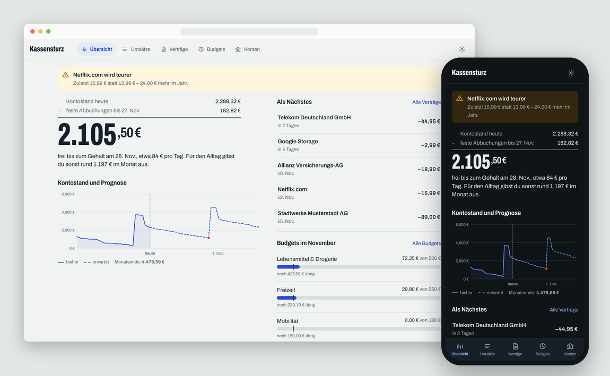

# Kassensturz

Kassensturz ist ein Haushaltsbuch für Home Assistant. Es sammelt die Umsätze deiner Konten, ordnet sie Kategorien zu,
erkennt Verträge und Abos und rechnet aus, wie viel bis zum nächsten Gehalt noch frei ist. Alle Daten bleiben auf deinem
Home-Assistant-Gerät.



## Erste Schritte

1. App starten, unter *Info* „In der Seitenleiste anzeigen“ einschalten und **Kassensturz** öffnen.
2. Eine Bank per Open Banking oder FinTS verbinden, eine Kontoauszug-Datei importieren oder erst einmal die Beispieldaten laden.
3. Für Konten ohne Saldo in der Datei (zum Beispiel Kreditkarten) einmal den aktuellen Kontostand eintragen.

Nach etwa drei Monaten Umsätzen erkennt Kassensturz die meisten Verträge von selbst.

## Was die Übersicht zeigt

Oben steht die Rechnung, die der App den Namen gibt: Kontostand heute, minus feste Abbuchungen bis zum nächsten
Gehalt, ergibt den Betrag, der für den Alltag frei ist. Darunter der Verlauf der letzten 30 Tage mit Prognose für die nächsten
45 Tage. Die Prognose rechnet erkannte Verträge zum jeweiligen Termin ein und für alles andere deine typischen Alltagsausgaben
der letzten drei Monate.

In die Summe fließen alle Konten ein, bei denen „Zählt zum Kontostand und zur Prognose“ aktiv ist. Tagesgeldkonten sind
standardmäßig ausgenommen.

## Bankabruf per Open Banking

Banken müssen in der EU eine Schnittstelle für Kontoumsätze anbieten (PSD2) – auch Neobanken wie N26 und Revolut, die kein
FinTS haben. Nutzen dürfen sie nur lizenzierte Dienste. Kassensturz verwendet dafür [Enable Banking](https://enablebanking.com):
Im „eingeschränkten Produktivmodus“ ist der Dienst für eigene Konten und private Nutzung kostenlos.

**Einmalig bei Enable Banking:**

1. Registrieren und im Control Panel unter *API applications* eine neue App anlegen: Umgebung *Production*, Redirect-URL
   `https://enablebanking.com/`, Schlüssel im Browser erzeugen lassen. Der Browser lädt eine `.pem`-Datei herunter.
2. Bei der App *Activate by linking accounts* wählen und deine Konten einmal verknüpfen. Nur so verknüpfte Konten lassen
   sich später abrufen.

**In Kassensturz:** *Konten → Open Banking einrichten*, App-ID und `.pem`-Datei eintragen. Danach *Bank verbinden*, Bank
auswählen, bei der Bank freigeben. Du landest anschließend auf der Seite von Enable Banking – die komplette Adresse aus der
Adresszeile kopierst du zurück in Kassensturz. Die Konten werden angelegt oder, wenn schon ein Konto mit derselben IBAN
existiert (etwa aus einem Datei-Import), mit diesem verknüpft.

**Abruf:** täglich zur eingestellten Uhrzeit und jederzeit von Hand. Beim ersten Abruf holt Kassensturz bis zu ein Jahr
Umsätze, sofern die Bank das erlaubt, sonst die letzten 89 Tage. Ohne dein Zutun erlauben Banken nur wenige Abrufe pro Tag.

**Freigabe erneuern:** Je nach Bank gilt die Freigabe bis zu 180 Tage. Eine Woche vor Ablauf erscheint ein Hinweis (auch als
Benachrichtigung); *Erneuern* führt durch dieselben Schritte, die Konten bleiben verknüpft.

Welche Banken Enable Banking anbindet, siehst du in der Bankauswahl. Manche stehen unter dem Land ihres Sitzes, PayPal und
Advanzia etwa unter Luxemburg. Der private Schlüssel liegt nur auf dem Gerät und ist von Backups ausgenommen; nach einer
Wiederherstellung lädst du ihn einfach neu hoch.

## Bankabruf per FinTS

FinTS (früher HBCI) ist die Schnittstelle, über die auch Programme wie StarMoney oder Hibiscus Umsätze abrufen.
Sparkassen, Volks- und Raiffeisenbanken, ING, DKB, comdirect und viele weitere bieten sie an.

**Produkt-ID:** Seit 2019 akzeptieren Banken nur registrierte Programme. Die Registrierung bei der Deutschen Kreditwirtschaft
ist kostenlos (Formular auf [fints.org](https://www.fints.org/de/hersteller/produktregistrierung)); die Zuteilung kann bis zu
zwei Wochen dauern. Die erhaltene ID trägst du in der Konfiguration der App unter `fints_product_id` ein.

**Bankzugang anlegen:** Unter *Konten → Bank verbinden → FinTS*. Du brauchst die Bankleitzahl (Stelle 5 bis 12 deiner IBAN),
deinen Anmeldenamen aus dem Online-Banking und die FinTS-Serveradresse deiner Bank. Für ING, DKB, comdirect und die
Volksbanken ist die Adresse vorbelegt. Sparkassen nennen sie auf ihrer Website unter „HBCI“ oder „FinTS“.

**TAN:** Beim ersten Abruf fragt Kassensturz nach deinem TAN-Verfahren. Bei App-Verfahren (pushTAN, SecureGo plus,
Banking to go, DKB-App, photoTAN-Push) bestätigst du einfach in der App; Kassensturz wartet darauf. chipTAN mit Flickercode
und photoTAN-Grafiken werden direkt angezeigt.

**Automatischer Abruf:** Wenn du beim Abruf „PIN speichern“ wählst, ruft Kassensturz täglich zur eingestellten Uhrzeit ab.
Die PIN liegt dann in `/data/secrets.json` auf dem Gerät – nicht verschlüsselt, aber von Home-Assistant-Backups ausgenommen.
Die meisten Banken verlangen alle 90 bis 180 Tage eine neue TAN-Freigabe; dann meldet sich Kassensturz per Benachrichtigung
und du startest den Abruf einmal von Hand.

## Datei-Import

Für Konten, die weder Open Banking noch FinTS abdecken, und als Alternative für alle anderen. Erkannt werden:

| Bank | Format | Wo zu finden (meist) |
|---|---|---|
| Sparkasse | CSV-CAMT, CSV-MT940, CAMT (XML/ZIP), MT940 | Umsätze → Export |
| Volksbank / Raiffeisenbank | CSV | Umsätze → Export |
| ING | CSV | Umsätze → Download |
| DKB | CSV | Umsätze → Export |
| comdirect | CSV | Umsätze → Export |
| N26 | CSV | Web-App → Downloads |
| Revolut | CSV | Konto → Kontoauszug → Excel/CSV |
| PayPal | CSV | Aktivitäten → Kontoauszüge → Benutzerdefiniert |
| American Express | CSV | Umsätze → Herunterladen |
| alle anderen | CSV mit Datum und Betrag | Spalten lassen sich im Import zuordnen |

Kassensturz merkt sich die Spaltenzuordnung je Dateiformat. Überlappende Zeiträume sind kein Problem: Pro Tag und Betrag wird nur
übernommen, was noch fehlt – auch wenn dasselbe Konto mal per Datei und mal per FinTS gefüllt wird.

Bei Kreditkarten stehen Ausgaben in manchen Exporten ohne Minus. Kassensturz weist darauf hin; die Option
„Vorzeichen umkehren“ steht in der Spaltenzuordnung.

## Eingangsordner

Damit Dateien nicht von Hand hochgeladen werden müssen, überwacht Kassensturz den Ordner `/share/kassensturz`
(Option `import_folder`). Was dort landet, wird innerhalb einer Minute importiert und danach nach `importiert/` verschoben.

- **iPhone:** Export in der Bank-App teilen → *In Dateien sichern* → Server `homeassistant.local`, Freigabe `share`, Ordner
  `kassensturz`. Den Server fügst du einmal in der Dateien-App unter *Mit Server verbinden* hinzu (Samba-App in Home
  Assistant nötig).
- **Android:** mit einer Datei-App, die SMB kann, oder einer Sync-App, die in die Freigabe schreibt.
- **Rechner:** per Samba nach `\\homeassistant.local\share\kassensturz` kopieren.

Das Konto erkennt Kassensturz an der IBAN in der Datei, an einer früheren Zuordnung desselben Dateiformats oder am Format
(PayPal, Amex, N26 …), wenn es genau ein passendes Konto gibt. Kann es nicht zuordnen, bleibt die Datei liegen und erscheint
unter *Konten → Eingangsordner* mit dem Knopf *Zuordnen*. Ab dann geht dasselbe Format ohne Rückfrage.

## Vermögen: Depot, Festgeld, VL, Immobilie, Kredit

Was Vermögen ist, aber keine abrufbaren Umsätze hat, legst du unter *Konten → Konto ohne Import anlegen* mit der passenden
Art an: Depot, Festgeld, VL / Bausparen, Immobilie oder Kredit. Statt Buchungen trägst du über *Wert eintragen* den aktuellen
Wert ein. Jeder Eintrag bleibt erhalten, die Kontenseite zeigt die Veränderung seit dem vorherigen Wert.

- **Kredit:** Du trägst die Restschuld ein, zum Beispiel vom Jahreskontoauszug. Sie zählt im Vermögen als Minus. Die
  monatliche Rate erkennt Kassensturz weiterhin als Vertrag auf dem Girokonto.
- **Festgeld und Kredit** haben ein Datum für Fälligkeit bzw. Laufzeitende. 30 Tage vorher erscheint ein Hinweis.
- **Sparkonto** verhält sich wie Tagesgeld und kann Umsätze haben.

Alle diese Konten zählen zum Vermögen, aber nicht zu „frei verfügbar“ und zur Prognose. Die Kontenseite teilt das Vermögen
in Alltag, Rücklagen, Depots, Immobilien und Kredite und zeigt den Verlauf der letzten Monate. Einzelne Wertpapiere, Kurse,
Zinsen und Tilgungspläne kennt Kassensturz nicht.

## Lernen aus Korrekturen

Änderst du bei einer Buchung die Kategorie, merkt sich Kassensturz den Empfänger. Alle anderen Buchungen dieses Empfängers,
alte wie künftige, bekommen dieselbe Kategorie; von Hand gesetzte bleiben. Das Gelernte steht unter *Einstellungen →
Gelernt* und lässt sich dort einzeln vergessen. Eigene Regeln haben Vorrang vor Gelerntem, Gelerntes vor der eingebauten
Erkennung. Gelernt wird nur aus deinen eigenen Daten auf deinem Gerät.

## Kann ich mir das leisten?

Auf der Übersicht trägst du einen Betrag ein. Kassensturz rechnet, als würdest du ihn heute ausgeben:

- **Ja:** Danach bleibt bis zum nächsten Gehalt mindestens so viel, wie du sonst im Alltag ausgibst.
- **Knapp:** Es reicht für die festen Abbuchungen, aber für den Alltag bleibt weniger als üblich, oder die Prognose fällt
  unter deine Warnschwelle.
- **Nein:** Der Betrag ist höher als das, was nach den festen Abbuchungen frei ist.

Die Antwort ist eine Rechnung aus deinen bisherigen Zahlen, keine Beratung.

## Monatsabschluss

Die Budgetseite fasst jeden Monat in Worten zusammen: wie viel du gespart hast, die Sparquote, ob die Ausgaben über oder
unter dem Schnitt der letzten drei Monate lagen, welche Kategorien auffallen und was die größte Einzelausgabe war. In der
ersten Woche des neuen Monats kommt der Abschluss des Vormonats als Benachrichtigung.

## Sparziele und Jahreskosten

**Sparziele** legst du auf der Budgetseite an: wofür, wie viel, optional bis wann und auf welchem Konto das Geld liegt. Mit
Konto zählt dessen Stand als gespart; hängen mehrere Ziele am selben Konto, wird er in der Reihenfolge verteilt, in der du
die Ziele angelegt hast. Ohne Konto trägst du den gesparten Betrag selbst ein. Mit Datum zeigt Kassensturz, wie viel du im
Monat zurücklegen musst.

**Jahreskosten** sind Verträge, die viertel-, halb- oder jährlich abgebucht werden. Kassensturz verteilt jede Zahlung über
ihren Abstand: Eine Versicherung über 600 € im Jahr braucht 50 € im Monat, sechs Monate nach der letzten Abbuchung sollten
also 300 € da sein. Die Budgetseite zeigt die Summe und jeden Vertrag einzeln.

Unter *Einstellungen* kannst du diese Rücklage von „frei verfügbar“ abziehen lassen. Lass das aus, wenn du dafür schon Geld
auf einem Tagesgeld- oder Sparkonto zurücklegst, sonst zählt es doppelt.

## Selbsttest des Kontostands

Nach jedem Abruf per FinTS oder Open Banking vergleicht Kassensturz, ob sich der Kontostand der Bank genau um die neu
abgerufenen Buchungen geändert hat. Bleibt über mindestens drei Tage ein Rest, fehlt vermutlich eine Buchung oder eine ist
doppelt. Dann erscheint ein Hinweis mit dem Betrag. Der angezeigte Kontostand stammt immer von der Bank und stimmt;
betroffen sind Auswertung und Budgets. Hast du die Ursache gefunden oder ist sie dir egal, blendest du den Hinweis im Konto
über *Geprüft, Hinweis ausblenden* aus. Der erste Abruf eines Kontos legt nur den Ausgangspunkt fest. Für Konten ohne
Bankabruf gibt es keinen Selbsttest.

## Umbuchungen und doppelte Ausgaben

Ein Einkauf über PayPal taucht zweimal auf: als Abbuchung „PayPal Europe“ auf dem Girokonto und als Zahlung an den Händler im
PayPal-Konto. Kassensturz wertet die Abbuchung als Umbuchung, sobald du das PayPal-Konto ebenfalls importierst. Gleiches gilt
für Kreditkartenabrechnungen, Klarna und Überweisungen zwischen eigenen Konten (erkannt an der IBAN). Steuern lässt sich das je
Konto über das Feld „Abbuchungen auf anderen Konten, die dieses Konto ausgleichen“.

## Kategorien und Regeln

Gut 500 Suchbegriffe für deutsche Händler, Versicherer, Energie- und Telefonanbieter sind eingebaut. Wenn du bei einer Buchung
die Kategorie änderst, schlägt Kassensturz eine Regel vor („Auch künftig so zuordnen, wenn … vorkommt“) und zeigt, wie viele
Buchungen sie betrifft. Eigene Regeln gehen den eingebauten vor und stehen unter *Einstellungen*. Buchungen lassen sich auf
mehrere Kategorien aufteilen.

## Verträge und Kündigungen

Wiederkehrende Zahlungen werden über Gläubiger-ID und Mandatsreferenz erkannt, sonst über Name und Rhythmus (wöchentlich bis
jährlich). Steigt der Betrag, erscheint ein Hinweis mit den Mehrkosten pro Jahr. Zu jedem Vertrag kannst du Kundennummer,
Vertragsende und Kündigungsfrist hinterlegen; Kassensturz erinnert dann rechtzeitig vor Fristende.

„Kündigung schreiben“ erzeugt ein Kündigungsschreiben (fristgerecht, zu einem Datum oder als Sonderkündigung bei
Preiserhöhung) inklusive Widerruf des SEPA-Mandats. Es lässt sich als E-Mail öffnen, kopieren oder als PDF drucken.
Dafür einmal unter *Einstellungen* Name und Anschrift eintragen. Die Schreiben sind Vorlagen, keine Rechtsberatung.

## Home Assistant

Mit `sensors: true` legt Kassensturz diese Sensoren an und aktualisiert sie alle 15 Minuten sowie nach jedem Import:

| Sensor | Inhalt |
|---|---|
| `sensor.kassensturz_kontostand` | Summe der Konten in der Prognose, Einzelstände als Attribut |
| `sensor.kassensturz_frei_verfuegbar` | frei bis zum nächsten Gehalt, Attribute `bis` und `pro_tag` |
| `sensor.kassensturz_prognose_monatsende` | erwarteter Stand am Monatsende |
| `sensor.kassensturz_tiefster_stand` | tiefster erwarteter Stand der nächsten 45 Tage, Attribut `datum` |
| `sensor.kassensturz_fixkosten_monat` | Summe aller laufenden Verträge pro Monat |
| `sensor.kassensturz_ausgaben_monat` | Ausgaben im laufenden Monat |
| `sensor.kassensturz_naechste_zahlung` | nächste feste Abbuchung, Attribute `empfaenger` und `datum` |
| `sensor.kassensturz_konto_*` | ein Sensor je Konto |
| `sensor.kassensturz_budget_*` | Restbudget je Kategorie mit Budget |

Benachrichtigungen gibt es, wenn die Prognose unter `warn_threshold` fällt, ein Vertrag teurer wird, eine Kündigungsfrist naht,
ein Budget überschritten ist, der tägliche Abruf eine TAN braucht oder neue Buchungen eingegangen sind
(abschaltbar mit `notify_new_transactions`). Ohne `notify_service` landen sie als persistente
Benachrichtigung in Home Assistant, mit zum Beispiel `notify.mobile_app_pixel` direkt auf dem Handy.

Beispiel für eine Dashboard-Karte:

```yaml
type: entities
title: Finanzen
entities:
  - entity: sensor.kassensturz_frei_verfuegbar
    name: Frei bis zum Gehalt
  - entity: sensor.kassensturz_kontostand
    name: Kontostand
  - entity: sensor.kassensturz_prognose_monatsende
    name: Prognose Monatsende
  - entity: sensor.kassensturz_naechste_zahlung
    name: Nächste Abbuchung
```

Die Sensoren werden über die API gesetzt und haben deshalb keine eindeutige ID; Name und Symbol lassen sich in der
Oberfläche nicht ändern. Nach einem Neustart von Home Assistant sind sie spätestens nach 15 Minuten wieder da.

## Optionen

| Option | Bedeutung |
|---|---|
| `fints_product_id` | Produkt-ID für den Bankabruf |
| `sync_time` | Uhrzeit des täglichen Abrufs (HH:MM) |
| `sensors` | Sensoren in Home Assistant anlegen |
| `notify_service` | z. B. `notify.mobile_app_pixel`, leer für persistente Benachrichtigungen |
| `notify_new_transactions` | Meldung bei neuen Buchungen aus dem automatischen Abruf und dem Eingangsordner (Standard: an) |
| `notify_month_review` | Monatsabschluss des Vormonats in der ersten Woche des Monats (Standard: an) |
| `warn_threshold` | Warnung, wenn die Prognose unter diesen Betrag in Euro fällt |
| `import_folder` | Eingangsordner, Standard `/share/kassensturz`; leer lässt ihn aus |

## Datenschutz

- Die Oberfläche ist nur über Home Assistant (Ingress) erreichbar, es wird kein Port nach außen geöffnet.
- Verbindungen gibt es nur zu deiner Bank (FinTS), zu Enable Banking (falls eingerichtet) und zu Home Assistant selbst. Die Schrift ist
  eingebettet, es werden keine externen Ressourcen geladen.
- Daten liegen in `/data/kassensturz.sqlite` und sind Teil der Home-Assistant-Backups; gespeicherte PINs und der
  Enable-Banking-Schlüssel nicht. Während einer Sicherung hält Home Assistant die App für wenige Sekunden an, damit die
  Datenbank vollständig und in sich stimmig gesichert wird.
- Zusätzlich legt die App einmal am Tag und vor dem ersten Start einer neuen Version eine Kopie der Datenbank in
  `/data/backups` ab (die letzten 7 Tageskopien, die letzten 3 vor einem Versionswechsel). Diese Kopien sind nicht Teil
  der Home-Assistant-Backups, weil dort die Datenbank selbst enthalten ist.
- Antwortet die App nicht mehr, startet Home Assistant sie über den Watchdog neu.
- *Einstellungen → Alle Buchungen als CSV* exportiert alles in einer Datei.

## Umzug in eine andere Installation

So ziehen alle Daten um, zum Beispiel von der lokalen App zur Installation über GitHub oder auf ein anderes Gerät:

1. In der alten Installation ein Home-Assistant-Backup anlegen.
2. *Einstellungen → Daten → Datenbank für Umzug* wählen. Der Browser lädt `kassensturz-umzug.sqlite` herunter. Die Datei
   enthält alle Konten und Umsätze; behandle sie wie einen Kontoauszug.
3. Die alte Installation stoppen, damit nicht zwei Instanzen dieselben Konten abrufen.
4. Die neue Installation einrichten, aber noch nicht starten. Die Datei in den Eingangsordner unter
   `umzug/kassensturz-umzug.sqlite` legen (Standard: `/share/kassensturz/umzug/`).
5. Die neue Installation starten. Im Protokoll steht „Daten aus der Umzugsdatei übernommen“, die Datei wird danach
   gelöscht. Optionen der App, PINs und den Enable-Banking-Schlüssel trägst du neu ein.
6. Stimmt alles, die alte Installation entfernen.

Die Übernahme findet nur statt, solange die neue Installation keine Konten und keine Umsätze hat. Hat sie schon Daten,
bleibt die Datei liegen und im Protokoll steht ein Hinweis.
