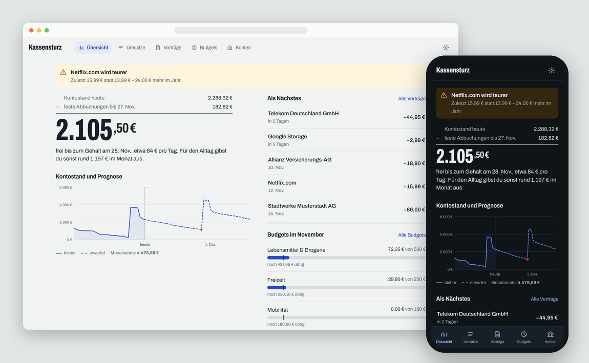

# Kassensturz

Haushaltsbuch für Home Assistant: Bankabruf per Open Banking und FinTS, Eingangsordner für Kontoauszüge, Vertragserkennung mit
Preiserhöhungs-Hinweis, Budgets, Prognose bis zum nächsten Gehalt und Kündigungsschreiben. Alle Daten bleiben lokal.

Die Anleitung steht im Reiter *Dokumentation*.
